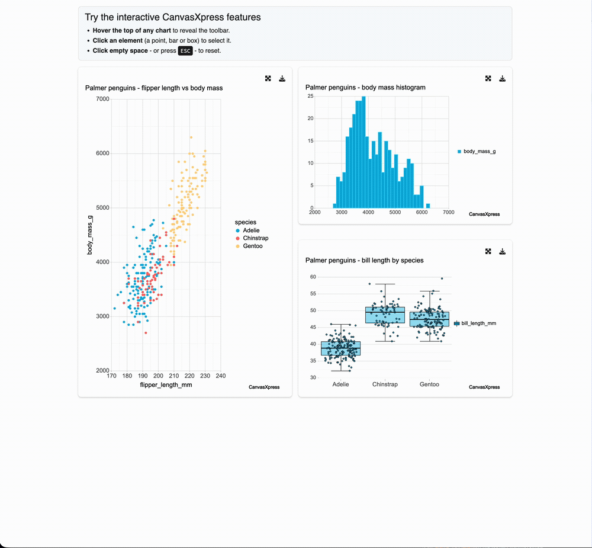

If you build Shiny apps with [teal](https://github.com/insightsengineering/teal), you know
`plot_with_settings` — the module that wraps a plot with resize, full-screen, and download
controls. Until now it rendered only *static* R graphics: ggplot, lattice, grob, base. Return
anything else from `plot_r` and it quietly fell through and never drew.

That leaves a gap. The analyst looking at a volcano plot, a Kaplan–Meier curve, or a forest plot
often wants to hover a point, select a group, and take the exact figure with them — not screenshot
a PNG. In a submission-grade workflow they also want that figure to be *reproducible*: the chart and
the code that made it, together.

## A small change with a big surface

[A PR on teal.widgets](https://github.com/pharmaverse/teal.widgets/pull/371) adds a render path for
interactive **htmlwidgets**. If `plot_r()` returns an htmlwidget — canvasXpress, plotly, anything
with a Shiny binding — `plot_with_settings` renders it through the widget's own binding, keeping the
familiar card chrome. Height, width, and full-screen work as before, and **download produces a
self-contained HTML file** you can email or archive.

It is strictly **opt-in**. Every existing static-plot caller behaves exactly as it did; the
interactive path triggers only when a module author chooses to return a widget.

```{r}
#| eval: false
library(shiny)
library(canvasXpress)
library(teal.widgets)

pg <- as.data.frame(na.omit(palmerpenguins::penguins))

ui <- bslib::page_fluid(plot_with_settings_ui("p"))

server <- function(input, output, session) {
  plot_with_settings_srv(
    "p",
    plot_r = reactive(canvasXpress(
      data = pg, graphType = "Scatter2D",
      xAxis = list("flipper_length_mm"), yAxis = list("body_mass_g"),
      colorBy = "species"
    ))
  )
}
shinyApp(ui, server)
```

The chart that lands in the card is a real canvasXpress widget — the same one you can render on its
own here. Hover a point, click to select, use the toolbar to export:

```{r}
#| message: false
library(canvasXpress)

pg <- as.data.frame(na.omit(palmerpenguins::penguins))

canvasXpress(
  data      = pg,
  graphType = "Scatter2D",
  xAxis     = list("flipper_length_mm"),
  yAxis     = list("body_mass_g"),
  colorBy   = "species",
  title     = "Palmer penguins — flipper length vs body mass"
)
```

Inside `plot_with_settings`, that interactivity sits in the usual card, with the resize and download
controls you already use:



## Describe the chart instead of configuring it

Because the render path is generic, you inherit whatever the widget can do. canvasXpress, for
instance, can build a chart from a plain-English prompt — no `graphType`, no axes:

```{r}
#| eval: false
plot_with_settings_srv(
  "p",
  plot_r = reactive(canvasXpress(
    data   = pg,
    prompt = "Create a scatter plot of bill_depth_mm vs body_mass_g and color by species"
  ))
)
```

## Try it live

There's a running demo — three canvasXpress plots inside `plot_with_settings` cards:

[**canvasxpress.shinyapps.io/teal-canvasxpress-demo**](https://canvasxpress.shinyapps.io/teal-canvasxpress-demo/)

or install the PR build and run it yourself:

```{r}
#| eval: false
pak::pak("pharmaverse/teal.widgets#371")
```

## Why it matters

Interactive dashboards usually mean leaving the tools you trust for a BI platform, and losing
reproducibility in the trade. This keeps both: the module model and reproducible, code-defined
figures of teal, plus the interactivity and portability of an htmlwidget. The figure is still
code — it just moves now.

The discussion that started it is
[teal#1757](https://github.com/pharmaverse/teal/discussions/1757); the PR is
[teal.widgets#371](https://github.com/pharmaverse/teal.widgets/pull/371). Feedback from teal users
is welcome, especially on how you'd want widget support wired into the module API.
